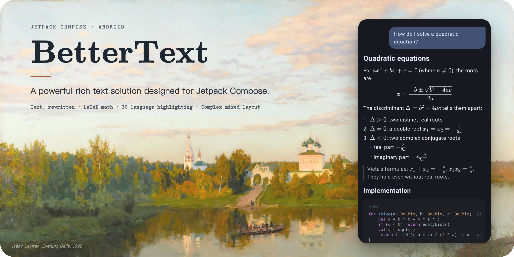

# BetterText

**English** · [简体中文](README.zh-CN.md)

[](https://github.com/re-ovo/bettertext/actions/workflows/ci.yml) [](https://jitpack.io/#re-ovo/bettertext)



A Jetpack Compose library for rendering the replies of LLM chat apps: Markdown with math, inline components and highlighted code, streamed in token by token.

Compose's Text handles this poorly. Inline content must fit a fixed-size placeholder that doesn't follow the text's baseline, a tall formula overlaps the lines around it, and a custom text layout can't take part in selection. Math renderers such as JLatexMath can't wrap a long inline formula across lines the way KaTeX does in a browser. BetterText lays out text itself and ports KaTeX for math, so formulas wrap and line up with the text, lines grow to fit them, and a whole reply can be selected and copied.

## Features

- **Inline math that wraps like KaTeX.** A Kotlin port of KaTeX 0.19.1 draws formulas with the KaTeX fonts and supports its functions, environments, macros and symbols. A long inline formula breaks after relations and binary operators, as in a browser.
- **Text with inline content.** Formulas, custom drawn items and composables such as citation tags sit in the text on its baseline. Lines grow to fit tall items instead of overlapping their neighbors.
- **Streaming Markdown.** Markdown with GFM, math and embedded HTML renders as a reply streams in. Only the changed end is parsed again, and unfinished syntax such as an unclosed bold or formula is closed or hidden instead of flashing as raw text.
- **Components from your app.** Code blocks, formulas, tables, images and details blocks come from the app, so Markdown doesn't depend on Material 3, and apps without math don't ship KaTeX.
- **Syntax highlighting.** A Kotlin port of highlight.js 11.11.1 highlights 30 languages.

## Installation

The modules are published on [JitPack](https://jitpack.io/#re-ovo/bettertext). Add the repository in `settings.gradle.kts`:

```kotlin
dependencyResolutionManagement {
    repositories {
        google()
        mavenCentral()
        maven("https://jitpack.io")
    }
}
```

Then add the BOM, with a release tag or a commit hash as the version, and the modules you need:

```kotlin
dependencies {
    implementation(platform("com.github.re-ovo.bettertext:bom:<version>"))
    implementation("com.github.re-ovo.bettertext:text")      // BetterText and selection
    implementation("com.github.re-ovo.bettertext:latex")     // formulas, includes text
    implementation("com.github.re-ovo.bettertext:markdown")  // Markdown, includes text
    implementation("com.github.re-ovo.bettertext:highlight") // syntax highlighting
}
```

Markdown shows formulas as source until the app registers the latex module's renderers, the same way it registers code blocks:

```kotlin
val components = MarkdownComponents(
    inlineMath = { formula -> LatexInline.cached(formula, context) },
    mathBlock = { formula ->
        val style = LocalMarkdownTextStyle.current
        LatexBlock(formula, fontSize = style.fontSize, color = style.color)
    },
)
```

## Compose limitations

Two open Compose issues prevent the text layer from building on `BasicText` and `SelectionContainer`:

- [427657659](https://issuetracker.google.com/issues/427657659): when `lineHeight` is set, every line gets the same height. A tall inline formula, or a span with a larger font, overlaps the lines next to it. Material 3 typography always sets `lineHeight`.
- [233102278](https://issuetracker.google.com/issues/233102278): `SelectionRegistrar` and `SelectionManager` are internal, so a custom text layout can't take part in `SelectionContainer`.

Until they are fixed, BetterText works around them with its own layout and selection. Once Compose fixes them, BetterText will switch to the built-in APIs.

## Building

Requires JDK 25.

```bash
./gradlew :latex:testDebugUnitTest   # unit tests (run on the JVM)
./gradlew :app:installDebug          # install the demo
```

The demo app (`:app`) has one tab per module: LaTeX (categorized samples, a line-wrapping demo and a live editor), rich text, Markdown (with a long conversation to select across) and code highlighting.

See [AGENTS.md](AGENTS.md) for the architecture and [latex/PORTING.md](latex/PORTING.md) for the porting conventions.

## License

BetterText is released under the [MIT License](LICENSE). The KaTeX code that `:latex` is ported from is also MIT-licensed (see [latex/KATEX_LICENSE](latex/KATEX_LICENSE)). The bundled KaTeX fonts are under the SIL Open Font License. The banner's background is Isaac Levitan's *Evening Bells* (1892), which is in the public domain.
