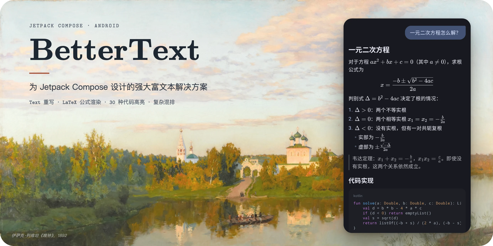

# BetterText

[English](README.md) · **简体中文**

[](https://github.com/re-ovo/bettertext/actions/workflows/ci.yml) [](https://jitpack.io/#re-ovo/bettertext)



一个用来渲染 LLM 聊天回复的 Jetpack Compose 库：带公式的 Markdown、行内组件和代码高亮，随 token 逐步流式输出。

Compose 的 Text 处理不好这些内容。行内内容只能放进固定尺寸的占位符，不跟随文字的基线；高的公式会和上下行重叠；自定义的文字排版也无法参与选择。JLatexMath 这类公式渲染器，没法像浏览器里的 KaTeX 那样把长的行内公式折到下一行。BetterText 自己排版文字，并移植了 KaTeX 来渲染公式，所以公式可以折行、和文字基线对齐，行高会随公式长高，整条回复也能选中复制。

## 特性

- **像 KaTeX 一样折行的行内公式。** KaTeX 0.19.1 的 Kotlin 移植，用 KaTeX 字体绘制公式，支持它的函数、环境、宏和符号。长的行内公式会在关系符和二元运算符后面折行，和浏览器里一样。
- **带行内内容的文字。** 公式、自定义绘制的内容，以及引用标记这类组件，都对齐文字基线排在行内。遇到高的内容，行会长高，而不是和相邻的行重叠。
- **流式 Markdown。** 支持 GFM、公式和内嵌 HTML，回复一边输出一边渲染。每次只重新解析变化的末尾；没写完的语法，比如没闭合的加粗或公式，会被补全或隐藏，不会先闪一下原文。
- **组件由应用提供。** 代码块、公式、表格、图片和折叠块由应用注册，所以 Markdown 不依赖 Material 3，不需要公式的应用也不用打包 KaTeX。
- **代码高亮。** highlight.js 11.11.1 的 Kotlin 移植，支持 30 种语言。

## 安装

各模块发布在 [JitPack](https://jitpack.io/#re-ovo/bettertext) 上。先在 `settings.gradle.kts` 里添加仓库：

```kotlin
dependencyResolutionManagement {
    repositories {
        google()
        mavenCentral()
        maven("https://jitpack.io")
    }
}
```

再添加 BOM（版本号填发布的 tag 或 commit hash）和需要的模块：

```kotlin
dependencies {
    implementation(platform("com.github.re-ovo.bettertext:bom:<version>"))
    implementation("com.github.re-ovo.bettertext:text")      // BetterText 和文字选择
    implementation("com.github.re-ovo.bettertext:latex")     // 公式，包含 text
    implementation("com.github.re-ovo.bettertext:markdown")  // Markdown，包含 text
    implementation("com.github.re-ovo.bettertext:highlight") // 代码高亮
}
```

Markdown 里的公式默认显示源码，应用要像注册代码块一样，注册 latex 模块的渲染：

```kotlin
val components = MarkdownComponents(
    inlineMath = { formula -> LatexInline.cached(formula, context) },
    mathBlock = { formula ->
        val style = LocalMarkdownTextStyle.current
        LatexBlock(formula, fontSize = style.fontSize, color = style.color)
    },
)
```

## Compose 的限制

Compose 有两个尚未解决的问题，导致文字层没法基于 `BasicText` 和 `SelectionContainer` 实现：

- [427657659](https://issuetracker.google.com/issues/427657659)：设置 `lineHeight` 后，每一行的高度都相同。高的行内公式或字号更大的文字会和相邻的行重叠。而 Material 3 的排版样式总是设置了 `lineHeight`。
- [233102278](https://issuetracker.google.com/issues/233102278)：`SelectionRegistrar` 和 `SelectionManager` 是 internal 的，自定义的文字排版无法参与 `SelectionContainer`。

在这两个问题修复之前，BetterText 用自己的排版和选择来绕开它们。等 Compose 修复后，BetterText 会改用官方 API。

## 构建

需要 JDK 25。

```bash
./gradlew :latex:testDebugUnitTest   # 单元测试（在 JVM 上运行）
./gradlew :app:installDebug          # 安装示例应用
```

示例应用（`:app`）为每个模块提供一个标签页：LaTeX（分类示例、折行演示和实时编辑器）、富文本、Markdown（含一段可以跨消息选择的长对话）和代码高亮。

架构说明见 [AGENTS.md](AGENTS.md)，移植约定见 [latex/PORTING.md](latex/PORTING.md)。

## 许可

BetterText 以 [MIT 许可证](LICENSE) 发布。`:latex` 移植自的 KaTeX 代码同样采用 MIT 许可证（见 [latex/KATEX_LICENSE](latex/KATEX_LICENSE)），附带的 KaTeX 字体采用 SIL Open Font License。头图背景是伊萨克·列维坦的《晚钟》（1892），属于公有领域。
